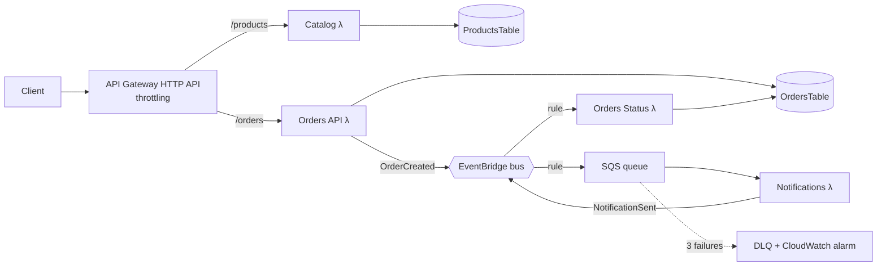

# Mini Orders — Event-driven Node.js Microservices on AWS

A small, production-shaped demo: **3 microservices** in Node.js 22, deployed on AWS with **IaC (SAM)**, **unit tests**, and a **GitHub Actions CI/CD pipeline** (OIDC, dev → prod with manual approval, live smoke tests).

## Architecture



**Flow:** `POST /orders` → saved as `PENDING` → `OrderCreated` event → SQS → Notifications service "sends email" → `NotificationSent` event → Orders service sets `CONFIRMED`. This is choreography-based (no central orchestrator).

| Service | Owns | Exposes / consumes |
|---|---|---|
| Catalog | ProductsTable | `POST /products`, `GET /products`, `GET /products/{id}` |
| Orders | OrdersTable | `POST /orders`, `GET /orders/{id}`; consumes `NotificationSent` |
| Notifications | — | consumes `OrderCreated` (via SQS); emits `NotificationSent` |

## Design decisions (interview talking points)

- **Database per service.** Only Orders writes to OrdersTable. Services talk through events, never through each other's tables.
- **EventBridge + SQS buffer.** EventBridge routes events. SQS sits in front of the consumer to absorb spikes, retry, and park poison messages in a **DLQ** (maxReceiveCount 3, with an alarm).
- **Partial batch response** (`ReportBatchItemFailures`). One bad message doesn't force the whole batch to retry.
- **Idempotency.** The status update is a conditional write (`status = PENDING`), so duplicate events are harmless. EventBridge and SQS are at-least-once.
- **Security.** Each function gets a least-privilege IAM role from SAM policy templates. CI/CD uses **GitHub OIDC**, so there are no long-lived AWS keys, and the role can only be assumed by this repo's environments.
- **Ops.** X-Ray tracing, structured JSON logs, 14-day log retention, API throttling, DynamoDB PITR.
- **Cost.** Fully serverless and pay-per-request on Graviton (arm64). At idle it costs ≈ $0, and demo traffic stays inside the free tier.

**Known trade-offs I'd fix in production:**
1. *Dual write.* The order is saved and then the event is published, which is not atomic. Fix: a **transactional outbox** (DynamoDB Streams → EventBridge Pipes).
2. Orders trust the `unitPrice` the client sends. Fix: validate against Catalog (sync call or a cached price replica fed by `ProductUpdated` events).
3. No auth yet. Add a Cognito/JWT authorizer on the HTTP API, plus WAF.
4. `Scan` on products. Fix: pagination and a GSI by category.
5. Multi-account. Separate dev and prod AWS accounts via Organizations/Control Tower. This demo uses separate stacks in a single account.

**Why Lambda rather than ECS/EKS here:** the traffic is spiky, the app is small, and there are no servers to patch. If the services needed long-running processes, websockets at scale, or steady high load, I'd run the same services as containers on **ECS Fargate behind an ALB**. The events, tables and pipeline would stay the same.

## Project layout

```
services/catalog        index.js           (HTTP)
services/orders         api.js, status.js  (HTTP + event consumer)
services/notifications  index.js           (SQS consumer)
tests/                  Jest + aws-sdk-client-mock unit tests
scripts/smoke-test.mjs  live end-to-end test against the deployed API
template.yaml           SAM / CloudFormation (all infrastructure)
infra/github-oidc.yaml  one-time OIDC deploy-role bootstrap
.github/workflows/ci-cd.yml
```

## Run it

### 0. Prerequisites
Node 22, AWS CLI v2 (`aws configure` done), SAM CLI, and a GitHub account.

### 1. Test locally
```bash
npm ci
npm test            # 17 tests with a coverage gate
sam validate --lint
sam build
```

### 2. First deploy from your laptop (fastest way to go live, about 3 minutes)
```bash
sam deploy          # uses samconfig.toml -> stack mini-orders-dev in ap-south-1
# copy the ApiUrl output, then:
API_URL=https://xxxx.execute-api.ap-south-1.amazonaws.com npm run smoke
```

### 3. Wire up CI/CD
```bash
# a) create the OIDC deploy role (one time)
aws cloudformation deploy --template-file infra/github-oidc.yaml \
  --stack-name mini-orders-github-oidc --capabilities CAPABILITY_NAMED_IAM \
  --parameter-overrides GitHubOrg=<your-github-username> \
  --region ap-south-1
# (use CreateOIDCProvider=false if your account already has the GitHub OIDC provider)

aws cloudformation describe-stacks --stack-name mini-orders-github-oidc \
  --query "Stacks[0].Outputs[0].OutputValue" --output text --region ap-south-1
```
b) In GitHub, create the repo `mini-orders` and push this code.
c) Under **Settings → Secrets → Actions**, add `AWS_DEPLOY_ROLE_ARN` = the ARN from step a.
d) Under **Settings → Environments**, create `dev` and `production`. Add yourself as a **required reviewer** on `production`.
e) Push to `main`. The pipeline runs **test → deploy-dev + smoke test → (approve) → deploy-prod + smoke test**. PRs run only the test job.

## Live demo script

```bash
API=https://xxxx.execute-api.ap-south-1.amazonaws.com

curl -s -X POST $API/products -H 'content-type: application/json' \
  -d '{"name":"Mechanical Keyboard","price":49.99}'

curl -s -X POST $API/orders -H 'content-type: application/json' \
  -d '{"customerEmail":"demo@example.com","items":[{"productId":"<id>","quantity":2,"unitPrice":49.99}]}'

curl -s $API/orders/<orderId>      # PENDING -> CONFIRMED within ~1-2s

# show failure handling: this one retries 3x then lands in the DLQ (alarm fires)
curl -s -X POST $API/orders -H 'content-type: application/json' \
  -d '{"customerEmail":"fail@example.com","items":[{"productId":"p1","quantity":1,"unitPrice":5}]}'
```
Then open **X-Ray → Trace map** to show the full request path, and **CloudWatch Logs Insights** to query the JSON logs.

## Teardown
```bash
sam delete --stack-name mini-orders-dev
sam delete --stack-name mini-orders-prod
```
