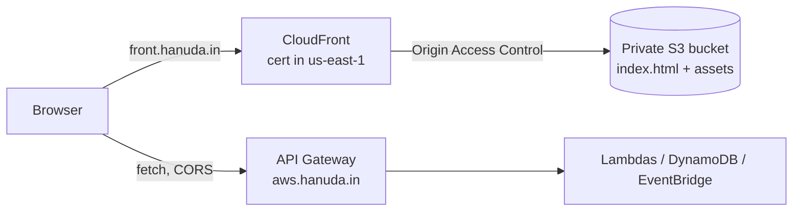

# Mini Orders Frontend — Plan

Goal: a React + TypeScript web app to **create, list and delete orders**, hosted on AWS at:

| Stage | Frontend URL | Talks to API |
|---|---|---|
| dev | `https://dev-front.hanuda.in` | `https://aws-dev.hanuda.in` |
| prod | `https://front.hanuda.in` | `https://aws.hanuda.in` |

It ships through the same GitHub pipeline as the backend: dev deploys on merge to `main`, and prod waits for your approval.

Related: [PROJECT_PLAN.md](PROJECT_PLAN.md) (backend plan), [DEPLOY_GUIDE.md](DEPLOY_GUIDE.md) (backend steps), **[FRONTEND_DEPLOY_GUIDE.md](FRONTEND_DEPLOY_GUIDE.md) (frontend deploy steps)**.

> **Status (2026-11-13):** F1, F2, F4, F5 and F6 are **built and tested locally**: 29 backend tests, 24 frontend tests, SAM validate, cfn-lint and actionlint all pass. Nothing new is deployed yet. F3 (certificate) and the actual deploys are in FRONTEND_DEPLOY_GUIDE.md. F7 (login) has not been started.
>
> Changes from this plan during the build:
> - One global stylesheet (`src/styles.css`) instead of CSS modules.
> - The new-order page has an inline "Add a product" form, so a fresh stage isn't stuck with an empty product list.
> - The pipeline creates the prod hosting stack itself, so only the dev stack is created by hand.
> - The GitHub variables are `ALLOWED_ORIGINS`, `FRONTEND_DOMAIN` and `FRONTEND_CERT_ARN`. The API URL is derived from the existing `DOMAIN_NAME`.
>
> **UI v2 (2026-11-13, deployed to dev only):** Tailwind CSS v4, mobile-first. Phones get a bottom tab bar, order cards and a sticky "Place order" bar; tablets and desktop get a table and a summary sidebar. Also new: stat cards, search plus status filter, a live indicator while orders are pending, and dark mode.
> - **Searchable product picker:** react-select, the React equivalent of jQuery Select2. jQuery plugins that change the DOM behind React's back cause state bugs.
> - **SweetAlert2:** delete confirmation, the "Add product" dialog and toasts. The order email is passed as `text`, never `html`, and there's a test proving it isn't rendered as markup.
> - **Installable:** a web app manifest and icons, so it can be added to a phone's home screen and opens full-screen.
> - **CSP trade-off:** react-select injects `<style>` tags at runtime, which a strict `style-src 'self'` breaks (verified in Chrome). So `style-src` now allows `'unsafe-inline'`. `script-src` stays `'self'` only, which is the part that stops XSS.

---

## 1. What has to change

| Area | Today | Needed |
|---|---|---|
| Create order | `POST /orders` exists | Nothing |
| List orders | **Missing.** Only `GET /orders/{id}` | New `GET /orders` |
| Delete order | **Missing** | New `DELETE /orders/{id}` |
| Product picker | `GET /products` exists | Nothing |
| Browser access | **No CORS**, so a browser on another domain is blocked | CORS on the HTTP API, limited to the two frontend domains |
| Hosting | None | S3 (private) + CloudFront + certificate + Cloudflare DNS |
| Pipeline | Backend only | Frontend test, build and deploy jobs |

## 2. Account constraints

This is a new-style AWS "project" account, locked to `ap-southeast-2` by an AWS-managed policy (see [DEPLOY_GUIDE.md](DEPLOY_GUIDE.md), Phase 2 troubleshooting). For the frontend that means:

| Need | Status (checked 2026-11-13) |
|---|---|
| S3 bucket in `ap-southeast-2` | Works. SAM already created one |
| CloudFront (a global service) | `list-distributions` and `list-origin-access-controls` succeed |
| ACM certificate in **us-east-1** (CloudFront only accepts certificates from us-east-1) | `list-certificates --region us-east-1` succeeds. **Requesting one is untested** |
| CloudFormation in us-east-1 | **Denied.** Fine: the hosting stack lives in `ap-southeast-2`, and only the certificate is in us-east-1 |

If the us-east-1 certificate request is denied in Phase F3, use the **fallback** in section 9.

## 3. Architecture



- **Static hosting:** Vite builds to plain files. S3 stores them privately, and only CloudFront can read them, through Origin Access Control (OAC). The bucket is never public.
- **Separate origins:** the app calls the API directly (`aws.hanuda.in`) with CORS. The backend stays exactly as deployed, and you can talk about CORS as a deliberate choice. The alternative, routing `/api/*` through CloudFront, avoids CORS but adds coupling.
- **Per-stage config:** the API URL is baked in at build time via `VITE_API_URL`, so dev and prod builds differ only by that value.
- **DNS:** Cloudflare CNAME records, **grey cloud (DNS only)**, the same as the API.

## 4. Backend changes

### 4.1 `GET /orders` — list

- Handler: `listOrders` in [services/orders/api.js](../services/orders/api.js), plus a new route in `template.yaml`.
- Query: `?limit=20&cursor=<opaque>`. The response is `{ items: Order[], nextCursor?: string }`.
- Implementation: `Scan` with `Limit` and `ExclusiveStartKey`. The cursor is `LastEvaluatedKey` in base64url. Validate the decoded cursor shape and return 400 on garbage, so it is never passed blindly to DynamoDB.
- Sorting: a Scan is unordered, so the UI sorts each page by `createdAt`. That's fine for a demo. In production, add a GSI (`pk = "ORDER"`, `sk = createdAt`) and use Query with `ScanIndexForward=false`. Note this in the README trade-offs next to the existing products `Scan` item.

### 4.2 `DELETE /orders/{id}` — delete

- `DeleteCommand` with `ConditionExpression: attribute_exists(id)`. Returns **204** on success and **404** if the order doesn't exist (`ConditionalCheckFailedException`).
- Interaction with the async flow: if an order is deleted while `PENDING`, the later `NotificationSent` event hits the conditional update in [status.js](../services/orders/status.js) (`#s = :pending`). The condition fails on a missing item, the handler already treats that as a duplicate and ignores it, and nothing breaks. Add a unit test for exactly this case.
- Optional: publish `OrderDeleted` to EventBridge for symmetry. Not needed for the UI.
- **Security note:** with no auth, anyone who finds the API can delete any order. That's accepted for the demo because the data is fake and the throttle is 5 requests/second. The real fix is Phase F7 (login), and it's a good interview point. CORS does **not** protect this: it only restrains browsers, and `curl` ignores it.

### 4.3 CORS

Add to `HttpApi` in `template.yaml`:

```yaml
      CorsConfiguration:
        AllowOrigins: !Ref AllowedOrigins
        AllowMethods: [GET, POST, DELETE]
        AllowHeaders: [content-type]
        MaxAge: 600
```

Add a new `AllowedOrigins` parameter (type `CommaDelimitedList`):

| Stage | Value |
|---|---|
| dev | `https://dev-front.hanuda.in,http://localhost:5173` |
| prod | `https://front.hanuda.in` |

Prod deliberately doesn't allow localhost.

### 4.4 Tests and smoke test

- Unit tests: list (with and without a cursor, bad cursor → 400) and delete (204, 404, then the status consumer ignoring a deleted order). Keep the 80% coverage gate.
- [scripts/smoke-test.mjs](../scripts/smoke-test.mjs): after the confirmation check, the order appears in `GET /orders`, `DELETE` returns 204, and a second `GET` returns 404. As a bonus, this cleans up the smoke-test orders that currently pile up in prod (finding S4).

## 5. Frontend app

### 5.1 Stack

| Choice | Why |
|---|---|
| **Vite + React 18 + TypeScript (strict)** | Standard, fast builds, output is plain static files |
| **TanStack Query** | Fetching, caching, refetch after create or delete, and polling while an order is `PENDING` |
| **React Router** | Two routes: `/` (orders) and `/new` (create) |
| Plain CSS modules, no UI kit | Small bundle; nothing to explain away |
| **Vitest + React Testing Library + MSW** | Component tests against a mocked API |
| ESLint + `tsc --noEmit` | Run in CI |

### 5.2 Layout

```
frontend/
  index.html
  package.json            own deps, separate from the backend root
  vite.config.ts
  tsconfig.json
  .env.development        VITE_API_URL=https://aws-dev.hanuda.in
  src/
    main.tsx              QueryClient + Router
    api/
      client.ts           fetch wrapper: base URL, JSON, typed errors
      types.ts            Product, Order, OrderItem, OrderStatus, ListResponse
      orders.ts           listOrders, getOrder, createOrder, deleteOrder
      products.ts         listProducts
    pages/
      OrdersPage.tsx      table + delete
      NewOrderPage.tsx    form
    components/
      StatusBadge.tsx     PENDING (amber) / CONFIRMED (green)
      ConfirmDialog.tsx
      ErrorBanner.tsx
    test/                 MSW handlers + page tests
  infra/
    hosting.yaml          S3 + OAC + CloudFront (section 6)
```

### 5.3 Types (the contract with the backend)

```ts
export type OrderStatus = 'PENDING' | 'CONFIRMED';
export interface OrderItem { productId: string; quantity: number; unitPrice: number }
export interface Order {
  id: string; customerEmail: string; items: OrderItem[];
  total: number; status: OrderStatus; createdAt: string; confirmedAt?: string;
}
export interface Product { id: string; name: string; price: number; createdAt: string }
export interface Page<T> { items: T[]; nextCursor?: string }
```

### 5.4 Screens

```
┌ Mini Orders ─────────────────────────────── [dev] ┐
│ Orders                              [+ New order] │
│ ───────────────────────────────────────────────── │
│ Created        Customer          Total   Status   │
│ 13 Nov 11:40   demo@example.com  99.98   ●CONFIRMED [Delete]
│ 13 Nov 11:42   a@b.com           49.99   ●PENDING   [Delete]
│                                  [Load more]      │
└───────────────────────────────────────────────────┘

┌ New order ────────────────────────────────────────┐
│ Email     [ demo@example.com        ]             │
│ Product   [ Mechanical Keyboard ▾ ] Qty [2] [x]   │
│           [+ Add item]                            │
│ Total     99.98                                   │
│                          [Cancel] [Place order]   │
└───────────────────────────────────────────────────┘
```

Behaviour:
- **List:** the newest first on each page. "Load more" uses `nextCursor`. While any visible order is `PENDING`, refetch every 2 seconds, then stop. This shows the event flow live during the demo.
- **Create:** the product dropdown comes from `GET /products`. `unitPrice` is the product's price, not typed in. The same validation as the backend runs on the client (email, quantity ≥ 1, at least 1 item), and server errors still show. On success, go back to the list with the new order highlighted.
- **Delete:** a confirm dialog, then an optimistic removal from the list, rolled back if the API fails.
- **States:** a loading skeleton, an empty state ("No orders yet"), and an error banner with Retry for every request.
- **Stage badge:** shows `dev` on the dev site, so you never demo against the wrong one.
- **Failure demo:** a "Simulate failure" checkbox on the form fills `fail@example.com`, so the DLQ path can be shown from the UI. That order stays `PENDING` (finding S3).

## 6. Hosting infrastructure

`frontend/infra/hosting.yaml`, deployed once per stage as `mini-orders-frontend-dev` and `mini-orders-frontend-prod`, both in `ap-southeast-2`.

| Resource | Settings |
|---|---|
| `AWS::S3::Bucket` | Block all public access, SSE-S3 encryption, owner-enforced object ownership |
| `AWS::CloudFront::OriginAccessControl` | sigv4, always sign |
| `AWS::S3::BucketPolicy` | Allow `s3:GetObject` to `cloudfront.amazonaws.com` only when `AWS:SourceArn` = this distribution |
| `AWS::CloudFront::Distribution` | Alias `front.hanuda.in` or `dev-front.hanuda.in`; us-east-1 certificate (`sni-only`, TLSv1.2_2021); `DefaultRootObject: index.html`; HTTP→HTTPS redirect; `PriceClass_200` (includes India); HTTP/2 and HTTP/3; managed `CachingOptimized` cache policy |
| SPA fallback | `CustomErrorResponses`: 403 and 404 → `/index.html` with status 200, so a deep link like `/new` works on reload |
| Security headers | Response headers policy: HSTS, `X-Content-Type-Options`, `frame-ancestors 'none'`, and a CSP with `default-src 'self'; connect-src 'self' https://aws.hanuda.in` (or `https://aws-dev.hanuda.in` on dev) |
| Outputs | `BucketName`, `DistributionId`, `DistributionDomain` (the CNAME target, `dxxxx.cloudfront.net`) |

**Caching on upload:**
- `assets/*` (hashed filenames): `Cache-Control: public, max-age=31536000, immutable`
- `index.html`: `Cache-Control: no-cache`
- After each upload, invalidate `/index.html` only. Assets never need invalidating because their names change on every build.

## 7. Phases

| Phase | Outcome | Time | Depends on |
|---|---|---|---|
| F1. Backend API | `GET /orders`, `DELETE /orders/{id}` and CORS are deployed to dev. Unit and smoke tests are green | 1.5 h | — |
| F2. App scaffold | `npm run dev` lists and creates orders against `aws-dev.hanuda.in` from `localhost:5173` | 1 h | F1 |
| F3. Certificate | us-east-1 certificate for `front.hanuda.in` and `dev-front.hanuda.in` is **ISSUED** | 20 min | — (do in parallel with F1) |
| F4. Screens complete | Create, list with paging and polling, delete with confirm. All states handled. Component tests pass | 2–3 h | F2 |
| F5. Hosting (dev) | `hosting.yaml` deployed, build uploaded, Cloudflare CNAME added. `https://dev-front.hanuda.in` works end to end | 1 h | F3, F4 |
| F6. Pipeline + prod | CI runs lint, typecheck, test and build. CD deploys dev automatically and prod after approval. `https://front.hanuda.in` is live | 1 h | F5 |
| F7. *(Stretch)* Login | Cognito Hosted UI + JWT authorizer. Delete is allowed only on your own orders | 3–4 h | F6 |

Total without F7: about 7–8 hours, which fits 2 sittings (F1–F3, then F4–F6).

### F1 — Backend API (micro steps)
1. Add `listOrders` and `deleteOrder` to [services/orders/api.js](../services/orders/api.js) and their cases to the router `switch`.
2. In `template.yaml`, add routes `ListOrders` (`GET /orders`) and `DeleteOrder` (`DELETE /orders/{id}`) under `OrdersApiFunction` → `Events`. `DynamoDBCrudPolicy` already covers Scan and Delete.
3. Add the `AllowedOrigins` parameter and `CorsConfiguration` (section 4.3). Add `AllowedOrigins=...` to `samconfig.toml` and the workflow's `--parameter-overrides`, using a GitHub environment variable `ALLOWED_ORIGINS` per environment.
4. Write the unit tests, then run `npm test`, `sam validate --lint` and `sam build && sam deploy`.
5. Extend the smoke test (section 4.4) and run it against `https://aws-dev.hanuda.in`.
6. **Check:** the preflight request returns the right headers:
   ```bash
   curl -si -X OPTIONS https://aws-dev.hanuda.in/orders \
     -H 'Origin: https://dev-front.hanuda.in' -H 'Access-Control-Request-Method: DELETE' | grep -i access-control
   ```

### F2 — Scaffold
1. `npm create vite@latest frontend -- --template react-ts`, then `cd frontend && npm i @tanstack/react-query react-router-dom`.
2. Dev dependencies: `vitest @testing-library/react @testing-library/user-event jsdom msw`.
3. Turn on `"strict": true` in `tsconfig.json`. Add scripts: `typecheck` (`tsc --noEmit`), `test` (`vitest run`), `lint`.
4. Write `api/client.ts` and `types.ts`, then a bare list page. Run `npm run dev` and open `http://localhost:5173`.
5. Add `dist/` to the root `.gitignore`. `node_modules/` is already ignored at any depth.

### F3 — Certificate (us-east-1)
1. Request it:
   ```bash
   aws acm request-certificate --region us-east-1 \
     --domain-name front.hanuda.in --subject-alternative-names dev-front.hanuda.in \
     --validation-method DNS
   ```
   **If this returns `explicit deny in a service control policy`, stop and switch to the fallback (section 9).**
2. Get the 2 validation records (`describe-certificate ... --region us-east-1`) and add them in Cloudflare as CNAME, **grey cloud**. This is the same as DEPLOY_GUIDE step 3.3.
3. `aws acm wait certificate-validated --region us-east-1 --certificate-arn <FRONT_CERT_ARN>`

### F4 — Screens
Build in this order, each with a test: `StatusBadge` → `OrdersPage` (list, empty, error) → paging → polling → `ConfirmDialog` and delete (optimistic, with rollback test) → `NewOrderPage` (validation, submit, server error) → stage badge.

### F5 — Hosting (dev)
1. Write `frontend/infra/hosting.yaml` (section 6). Parameters: `Stage`, `DomainName`, `CertificateArn`, `ApiOrigin`.
2. Deploy it:
   ```bash
   aws cloudformation deploy --template-file frontend/infra/hosting.yaml \
     --stack-name mini-orders-frontend-dev --region ap-southeast-2 \
     --parameter-overrides Stage=dev DomainName=dev-front.hanuda.in \
       CertificateArn=<FRONT_CERT_ARN> ApiOrigin=https://aws-dev.hanuda.in
   ```
   CloudFront takes 5–10 minutes to deploy.
3. Build and upload:
   ```bash
   cd frontend && VITE_API_URL=https://aws-dev.hanuda.in npm run build
   aws s3 sync dist/assets s3://<BUCKET>/assets --cache-control "public,max-age=31536000,immutable" --delete
   aws s3 cp dist/index.html s3://<BUCKET>/index.html --cache-control "no-cache"
   aws cloudfront create-invalidation --distribution-id <DIST_ID> --paths /index.html
   ```
   Put these in `frontend/scripts/deploy.sh <stage>` so CI and the laptop run the same thing.
4. Cloudflare: CNAME `dev-front` → `dxxxx.cloudfront.net`, **grey cloud**.
5. **Check:** open `https://dev-front.hanuda.in`, create an order, watch it turn `CONFIRMED`, delete it, and reload on `/new`. There must be no CORS errors in the browser console.

### F6 — Pipeline and prod
1. `test` job: add a step in `frontend/`: `npm ci && npm run lint && npm run typecheck && npm test && npm run build`.
2. `deploy-dev` and `deploy-prod`: after the backend smoke test, run `frontend/scripts/deploy.sh`. It reads the bucket and distribution from the stack outputs and gets `VITE_API_URL` from a new environment variable `API_URL`. The deploy user's PowerUser policy already covers S3 and CloudFront.
3. Add `ALLOWED_ORIGINS` and `API_URL` to both GitHub environments (extend [scripts/setup-github.sh](../scripts/setup-github.sh)).
4. Deploy `mini-orders-frontend-prod` once by hand (F5 step 2 with prod values), then add Cloudflare CNAME `front`.
5. Merge to `main`, approve prod, and open `https://front.hanuda.in`.

### F7 — Login (stretch)
Cognito user pool with Hosted UI → an HttpApi JWT authorizer on all `/orders` routes → the backend stores `ownerSub` from the token on create, and `listOrders` and `deleteOrder` filter or condition on it. The frontend uses the auth-code + PKCE flow. Check first that `cognito-idp` is allowed on this account (`aws cognito-idp list-user-pools --max-results 1`).

## 8. Cost

- CloudFront's always-free allowance (1 TB out and 10 million requests a month) and S3's few-MB storage cover a demo. The certificate is free.
- One extra Scan per page view is negligible at demo traffic.
- Expected: $0, within the existing budget alerts.

## 9. Risks and fallbacks

| Risk | Likelihood | Fallback |
|---|---|---|
| Certificate request in us-east-1 denied by the account's policy | Low–medium (reads work; writes untested) | **AWS Amplify Hosting** in `ap-southeast-2` (`list-apps` works). Amplify manages the certificate itself and supports custom domains with Cloudflare DNS. The pipeline uploads the build with `aws amplify create-deployment` instead of S3 sync |
| Amplify custom domain also blocked | Low | Cloudflare **orange cloud** in front of the CloudFront default domain. Cloudflare serves the certificate, but CloudFront rejects unknown Host headers, so this needs a Host-header override rule. Check your Cloudflare plan supports it before relying on it |
| CORS errors in the browser | Medium on first try | Check the origin string exactly (scheme, no trailing slash) and the preflight `curl` in F1 step 6 |
| Stale UI after a deploy | Low | `index.html` is `no-cache` and invalidated on every deploy |
| Public delete abused | Low (demo data, 5 requests/second throttle) | F7 login; until then, it's mentioned as a known trade-off |

## 10. Definition of done

- [ ] `https://dev-front.hanuda.in` and `https://front.hanuda.in` load with valid certificates
- [ ] Create → `PENDING` → `CONFIRMED` happens live in the list without a manual refresh
- [ ] Delete removes the order, and `GET /orders/{id}` then returns 404
- [ ] Reloading `/new` works (SPA fallback)
- [ ] No CORS or CSP errors in the browser console. Prod rejects `http://localhost:5173`
- [ ] S3 bucket is not publicly readable: a direct `https://<bucket>.s3...` URL returns 403
- [ ] CI runs lint, typecheck, tests and build. Merge to `main` deploys dev, and prod waits for approval
- [ ] The smoke test covers list and delete, and leaves no orders behind
- [ ] Demo script updated: the UI replaces the `curl` order steps, and `curl` stays as a backup

## 11. Interview talking points this adds

- **CORS is not access control.** It stops other websites' JavaScript, not `curl`. That's why the public `DELETE` needs auth (F7).
- **Private bucket + OAC** rather than a public S3 website: no direct bucket access, and HTTPS on your own domain.
- **Cache strategy:** immutable hashed assets plus a `no-cache` `index.html` give instant rollouts with only one small invalidation.
- **Same pipeline, one artifact per stage:** the build differs only by `VITE_API_URL`.
